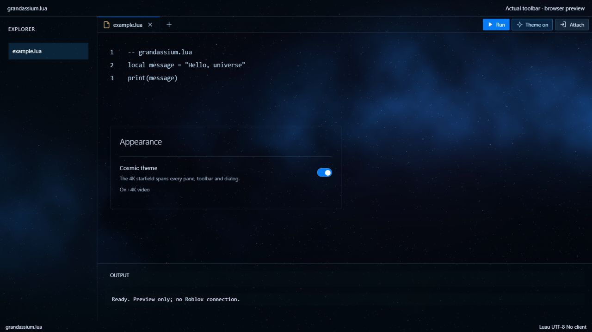

# grandassium.lua

Grandassium.lua is a Windows desktop Roblox executor with a blue/black interface
and a subtle, offline 4K cosmic video theme.

**[Download the latest Windows release](https://github.com/j4522419-code/grandassium/releases/latest)**

## Install

1. Download `Grandassium-windows-x64.zip` from the latest release.
2. Extract **all** files into a new folder.
3. Open `grandassium.lua.exe`. Keep the included runtime DLLs beside it.

The packaged application's existing sign-in requirements still apply.

## Interface

- One application name: **grandassium.lua**.
- A silent 3840 × 2160 cosmic video spans the editor, sidebar, console, title bar,
  settings and dialogs. The video is embedded and works offline.
- **Theme on / Theme off**, directly beside **Run**, switches the whole theme.
  The same setting is available under **Settings → Appearance → Cosmic theme**.
  Your choice is saved between launches.
- Turning the theme off restores the normal panels and stops video playback.
  Reduced-motion settings use a still background; hidden windows pause the video.
- Attach has an estimated progress indicator; Run has a short arrow animation.

The image is a browser demonstration of the actual toolbar in a sample layout,
with no live Roblox connection.

## Downloads and verification

This repository distributes the Windows build and documentation. The full native
application source is not included. Download the ZIP under a release's **Assets**;
GitHub's automatically generated source archives do not contain the application.

Compare the ZIP's SHA-256 with `SHA256SUMS.txt` attached to the same release.
UI controls, video playback, saved theme preferences and packaged assets were
checked. End-to-end Roblox attachment has not been verified.

The custom build's vendor GUI self-update is disabled because it would overwrite
the modified interface. New packages will be distributed through GitHub Releases.

See [NOTICE.txt](NOTICE.txt) for icon attribution.
